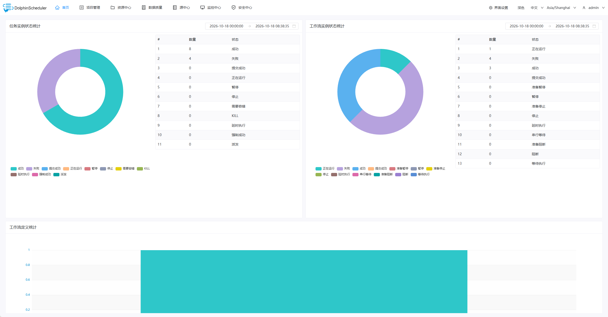
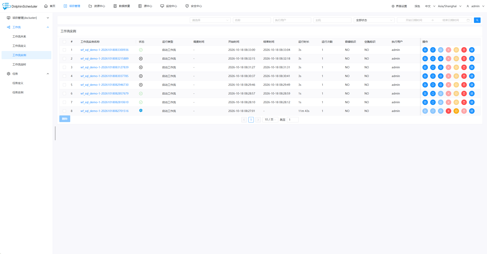
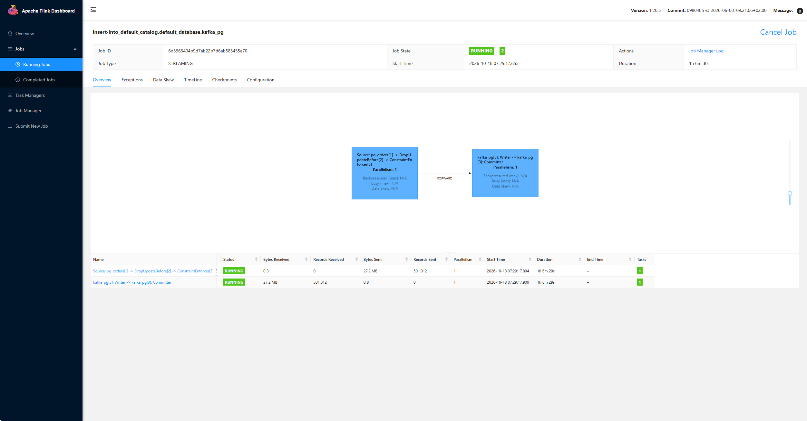
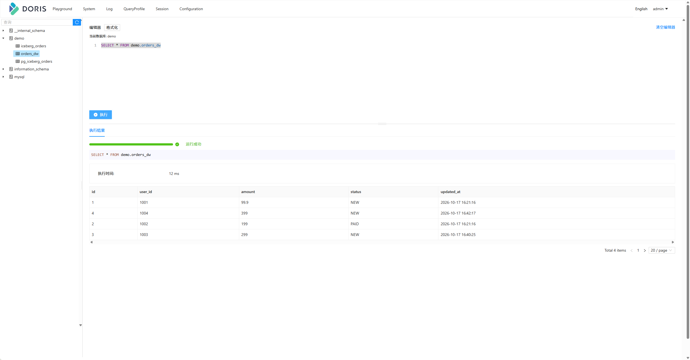
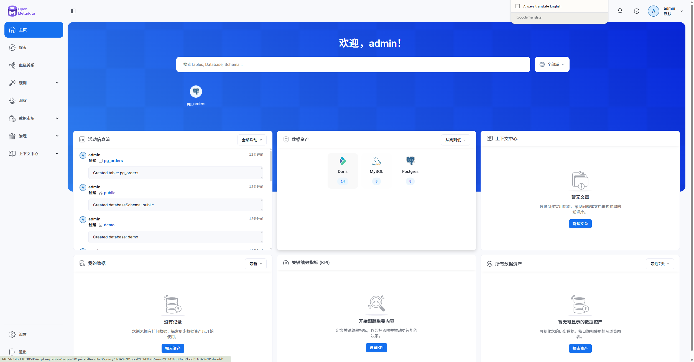
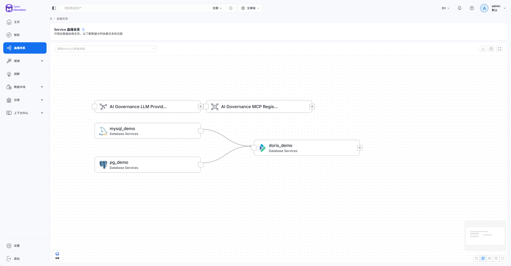
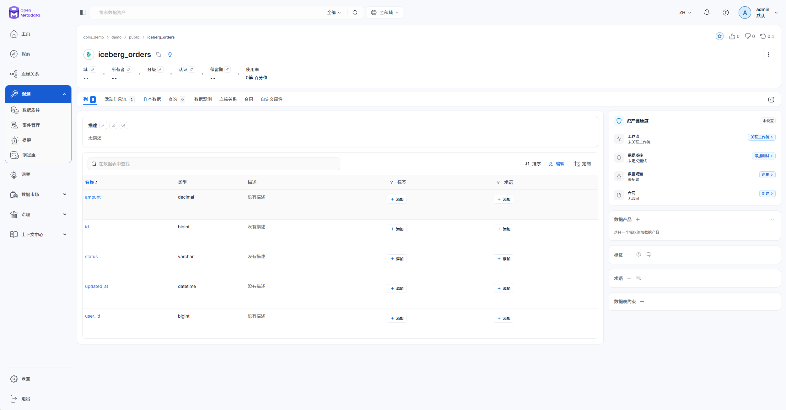
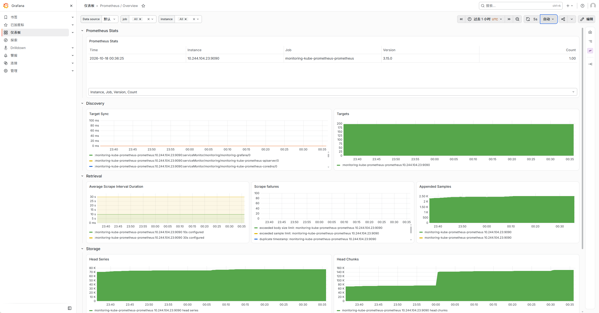
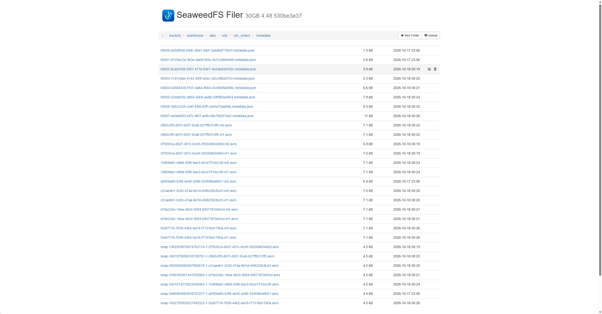
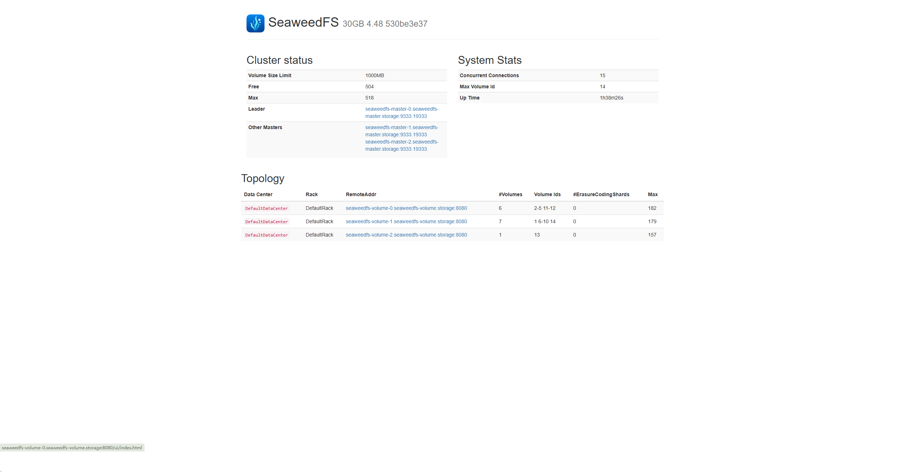

# 验收截图（2026-10-18 腾讯云测试环境）

> 本页集中存放本次 3 节点腾讯云测试环境的验收截图，正文分析见 [实战记录](04.实战记录.md)。
> 结论与资源释放清单见 [验收报告](07.验收报告.md)。
> 截图时间：2026-10-18 08:30 左右；实例为按量计费，环境已于当日 18:00 自动销毁。

## 1. DolphinScheduler 集群

集群模式已从 standalone+H2 切换为 **PostgreSQL 元数据 + 独立 ZooKeeper + master/worker/api/alert**。

实例 8 包含两个任务：

- `t1`：Shell 检查 Flink 两个 CDC 作业，输出 `flink-jobs-ok`
- `batch_doris`：SQL 任务查 PostgreSQL，输出 `{"total":501012}`

后续实例 40 把主链路定为 5 个任务：`spark-batch-job`（DS K8S 任务创建 Job，Job 内再向 K8s 提交 Spark driver/executor）、`flink-k8s-list`（Flink CLI 查作业）、`flink-k8s-cdc`（`sql-client` 提交 MySQL CDC → Kafka），五个任务全部 SUCCESS。`flink-k8s-run` WordCount 单独验证过，因 Flink slot 争用已移出主链路。

## 2. Flink 实时作业

MySQL CDC、PostgreSQL CDC 两个作业均 RUNNING；PostgreSQL CDC 已消费 501,012 条记录。

## 3. Doris

Doris FE 查询界面；测试环境中 Doris 承担 Iceberg 结果的热点副本查询。

> 说明：该截图展示的是 `demo.orders_dw` 的 4 行示例数据，不是 1M 行结果；Iceberg 已有 1,000,012 行（uncompressed 表），Doris 也已通过 Stream Load 写入 1,000,012 行；K8s Spark 批量聚合了 1,000,012 行并写出 `pg_orders_summary`。

## 4. OpenMetadata 元数据与血缘

OpenMetadata 已建 MySQL/PostgreSQL/Doris 服务、库、表实体，并写入 MySQL→Doris、PG→Doris 两条血缘边。

## 5. 监控

Grafana 使用 kube-prometheus-stack 的 Prometheus Overview 面板；Prometheus 采集正常。

## 6. SeaweedFS 对象存储

SeaweedFS 作为 S3 兼容对象存储，Iceberg 数据文件、DS resource center 都落在这里。

## 7. 结论与未完成项

| 项 | 结果 |
| --- | --- |
| DS 集群模式 | ✅ 5 个组件 Running，工作流实例 SUCCESS |
| 实时 CDC | ✅ MySQL/PG → Kafka → Iceberg → Doris |
| 批量任务 | ✅ DS SQL 任务查询 501,012 行 |
| 元数据/血缘 | ✅ 服务/表实体 + 两条血缘边 |
| 监控 | ✅ Grafana/Prometheus |
| Spark 监控 | ✅ Spark History Server 固定 NodePort 30082，事件日志已落 S3 |
| 对象存储 | ✅ SeaweedFS Filer/Master |
| 全 K8s 化 | ✅ Flink 已镜像化并跑在 node2/3；Spark K8s driver/executor + DS K8S 任务均已完成 |
| 1M 入湖 | ✅ MySQL/PG 1,000,012；Iceberg uncompressed 1,000,012；Doris Stream Load 1,000,012 |
| Harbor | ⚠️ 已部署并 push 镜像，K8s 通过内网拉取成功 |
| OpenLineage 自动采集 | ✅ Spark listener → ol-bridge → OM，`pg_orders_summary` upstreamEdges=1（桥接映射） |
